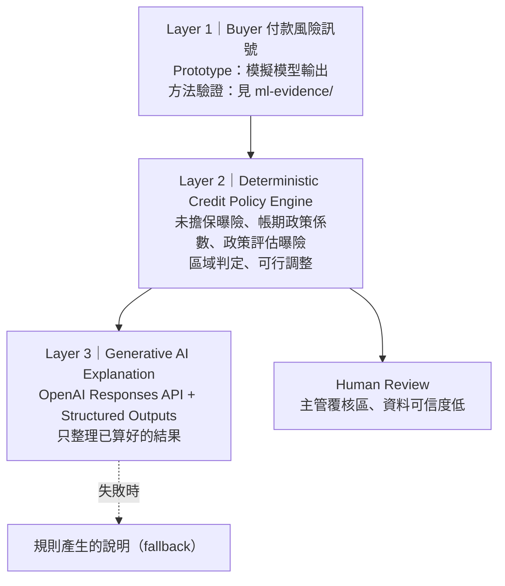

# 信任邊界 Trust Boundary

**AI 買家付款風險與條件式授信決策 Prototype**

> 不是只問「這個 Buyer 能不能交易」，而是回答：**這筆交易在什麼條件下可以成立？**

---

## 1. Problem

B2B 貿易常用固定信用額度（Credit Limit）管理 Buyer。但一筆真實交易，通常會遇到額度回答不了的問題：

- 金額比平常大很多呢？
- 帳期從 Net30 拉長到 Net90 呢？
- 如果 Buyer 願意先付一部分訂金呢？
- Buyer 本身很穩定，只是這一筆條件太激進呢？

同一個 Buyer，在不同交易條件下，賣方承擔的未擔保曝險完全不同。

**核心洞察：Buyer Risk ≠ Deal Risk。**
Buyer 的付款風險是一回事；這筆交易的金額、帳期與訂金，讓企業承擔多少曝險，是另一回事。改變帳期不會讓 Buyer 變得更守信，只會改變賣方的曝險。

## 2. Core Idea

```
Buyer 付款風險訊號
  → Prototype 授信基準（示範企業信用政策）
  → 本次交易條件：金額 × 帳期 × 訂金
  → 信任邊界（Trust Boundary）
  → 建議授信範圍 / 需要主管覆核 / 超出目前信用政策
  → 在不可談條件鎖定下，仍可行的調整方式
```

AI 不替人說 Yes / No；系統把「可以成立的範圍」畫出來，決策仍由人做。

## 3. Hero Experience

以 Prototype 模擬案例「明輝零組件」為例。Buyer 本身信用狀態穩定（B｜整體穩定），授信基準 NT$5.5M、目前曝險 NT$0.5M。

| 情境 | 交易條件 | 結果 |
|---|---|---|
| 原始交易 | NT$5.0M、Net90、訂金 0% | 政策評估曝險 NT$6.5M，**超出目前信用政策** |
| Buyer 堅持 Net90（鎖定帳期），只調整訂金 | 訂金 5% | **需要主管覆核** |
| 同上 | 訂金 20% | **進入建議授信範圍** |
| 其他單一調整 | 金額降至 NT$4.1M，或帳期改為 Net30 | 進入建議授信範圍 |

使用者可以鎖定 Buyer 不願讓步的條件。系統只會在其餘條件中，計算最小可行調整；按下「套用」後，交易點會在信任邊界圖上移動到新的區域。

> **【待補】Hero screenshot**：明輝零組件、鎖定 Net90、套用 20% 訂金前後的畫面。

## 4. Three Prototype Cases

以下三個 Buyer 都是 **Prototype 模擬案例**，不是真實企業，也不是真實信用資料。

| Buyer（模擬） | 想說明的事 |
|---|---|
| **明輝零組件** | Buyer 本身穩定，但這一筆交易的金額（典型的 5.0 倍）與帳期（+60 天）讓曝險超出信用邊界 |
| **新衡零售系統** | 付款流程摩擦 ≠ 信用惡化。近期曾出現 invoice approval delay，系統將它呈現為流程訊號，不直接視為信用惡化 |
| **光川貿易** | 新合作對象、內部資料不足。系統不提供假裝精準的風險分數；即使交易落在起始信用政策範圍內，仍要求人工覆核，不代表自動核准 |

## 5. Decision Architecture



**Layer 1｜Buyer 付款風險訊號**
Prototype 中的 Buyer 風險欄位是模擬模型輸出，網站內不會即時訓練模型。用付款歷史估計風險的方法本身，另外在 `ml-evidence/` 做了驗證（見第 6 節）。

**Layer 2｜Deterministic Credit Policy Engine**（`src/engine/decisionEngine.js`）

```
未擔保曝險      U = 交易金額 × (1 − 訂金比例)
政策評估曝險    E = 目前曝險 + U × 帳期政策係數
建議授信範圍    E ≤ 授信基準
需要主管覆核    E ≤ 授信基準 × 1.15
超出目前信用政策  其他
```

- 帳期政策係數（Net30 1.00、Net45 1.05、Net60 1.10、Net90 1.20）與覆核緩衝 1.15，是**示範企業自行設定的政策參數**，不是 AI 輸出，也不是業界標準
- 既有曝險不套用新交易的帳期係數
- 可行調整一次只調一個條件，且只從政策允許的帳期與訂金比例中選擇；找不到就誠實回傳「無法只靠這一項達成」

**Layer 3｜Generative AI Explanation**（`server/`）
OpenAI Responses API 搭配 strict JSON Schema，只回傳 `summary`、`buyer_status`、`deal_status`、`key_reasons`、`human_note` 五個欄位。

AI **不負責**：授信額度計算、區域判定、可行調整、最終核准。server 收到請求後，會用同一套決策引擎重新計算，AI 只拿到已算好的結果。

**Human Review**
落在主管覆核區，或 Buyer 資料可信度低時，系統明確標示需要人工決策。

> **【待補】Architecture diagram**：如需要，可用正式繪製的圖取代上方 Mermaid 圖。

## 6. ML Evidence

`ml-evidence/` 是與產品隔離的方法驗證實驗，回答一個問題：

> 企業能否利用 Buyer 過去的 invoice 付款紀錄，在一張新 invoice 開立的當下，估計它逾期超過 7 天的風險？

**資料**：Kaggle — Finance Factoring – IBM Late Payment Histories，2,466 張 invoice、100 個 customer、2012-01 至 2013-12。

**設計**

- Target：`late_7d` = 付款日 − 到期日 > 7 天
- 依開票日做時間切割（約 70% / 15% / 15%），不做隨機切割
- 只使用預測當下已知的資訊：歷史特徵只計入「在本張開票日之前已經付款完成」的同一 customer invoice；同日開立的 invoice 不互相當作歷史
- Label 可知性 purge：train / validation 只保留在下一段開始前就已確定結果的樣本
- `customerID` 不進模型；本張 invoice 的付款結果、Dispute、Paperless 欄位都不進模型
- Threshold 只在 validation 上選定，test 只評估一次

**樣本數（purge 後）**：train 1,633、validation 294、test 371（test 正例 41，正例比例 0.111）

**Test 結果**（late_7d；中括號為 1,000 次 bootstrap 95% 信賴區間）

| 方法 | PR-AUC | ROC-AUC | Brier |
|---|---|---|---|
| 簡單規則：Buyer 過去逾期 > 7 天的比例（不經訓練） | 0.550 [0.418, 0.692] | 0.886 [0.823, 0.937] | —¹ |
| Logistic Regression | 0.437 [0.316, 0.595] | 0.866 [0.817, 0.914] | 0.078 |
| Gradient Boosting（HistGradientBoostingClassifier）² | 0.459 [0.322, 0.612] | 0.865 [0.819, 0.911] | 0.080 |

- 沒有區辨能力的分數，PR-AUC（average precision）的期望值約等於正例比例，本 test set 為 0.111
- 一律預測 train 正例比例（0.206）的 Brier 為 0.107
- Logistic Regression 的機率大致有校準：預測最高的五分之一，平均預測 0.432，實際逾期比例 0.392；整體平均預測 0.136，實際 0.111，略為高估。test 期間的逾期率低於 train 期間（0.111 對 0.206）

¹ 簡單規則的分數是歷史比例，不是校準過的機率，Brier 不具比較意義。
² Gradient Boosting 的數字會隨 scikit-learn 版本小幅變動；上表為 scikit-learn 1.6.1（Google Colab）。在 1.9.1 上 test PR-AUC 為 0.451、ROC-AUC 為 0.872。Logistic Regression 與簡單規則在兩個版本下完全一致。

**其他檢查**

- 移除 `countryCode` 後，test PR-AUC 下降 0.013（Logistic）與 0.002（Gradient Boosting），模型沒有依賴這個只有 5 個值的地理變數
- 打亂 train label 重新訓練後，test PR-AUC 0.134、ROC-AUC 0.492，接近隨機，沒有發現隱藏的資料洩漏管道
- 以另一種寫法獨立重算歷史特徵、抽樣 300 筆比對：0 筆不一致
- `late_15d` 敏感度分析：test 只有 10 個正例，結果不穩定，不作為證據

完整數字見 `ml-evidence/reports/ml1_results.md`。

## 7. What the ML Evidence Means

在這份資料上，**簡單的歷史付款規則，表現不遜於兩個 ML 模型**：三者的信賴區間大幅重疊，無法判定誰較好；三者都明顯高於沒有區辨能力的基準。Gradient Boosting 的 permutation importance 也顯示，預測力主要來自過去的平均逾期天數與準時付款比例。

這不代表 ML 沒有價值。它代表：**付款歷史中可解釋的訊號本身就很強**。因此 Prototype 不應依賴黑箱模型製造虛假的精準感；Buyer 風險應該以可解釋的付款行為訊號為基礎。

正式部署時，應依企業自身的資料量與可取得的額外特徵（例如外部信用資料），實際比較簡單規則與 ML 模型的增益，再決定採用哪一種。

## 8. Reproducibility

`ml-evidence/` 內容：

| 路徑 | 內容 |
|---|---|
| `audit/ml0_data_audit.py` | 資料稽核（只使用 Python 內建模組） |
| `ml1/ml1_buyer_risk.py` | 特徵建立、時間切割、模型、評估、leakage audit |
| `requirements.txt` | pandas、numpy、scikit-learn |
| `colab/ml1_colab.ipynb` | Google Colab 重現用 notebook |
| `reports/` | 稽核與實驗的彙總報告（只含統計數字） |

**Raw dataset 不包含在本 repo**，因為資料授權條件尚未確認。

**方式一：Google Colab（已在全新 Colab 環境實際執行過）**
在 Colab 上傳 `ml-evidence/colab/ml1_colab.ipynb`，依序執行各區塊。需要網路：notebook 會從公開 GitHub repository（[putanynisworkaholic/SQL-IBM-Finance-Factoring-Late-Payment-Analysis](https://github.com/putanynisworkaholic/SQL-IBM-Finance-Factoring-Late-Payment-Analysis)）下載同一份 CSV，並以 SHA-256 驗證與 Kaggle 版本逐位元組相同：

```
651bc4225708bf33148a0e177c9221afdf697d3a4de10333725a4af3dd022fcf
```

**方式二：本機**
1. 從 Kaggle 下載資料：[Finance Factoring – IBM Late Payment Histories](https://www.kaggle.com/datasets/hhenry/finance-factoring-ibm-late-payment-histories)（需要 Kaggle 帳號），將 `WA_Fn-UseC_-Accounts-Receivable.csv` 放到 `ml-evidence/data/`
2. 執行：

```
python -m pip install -r ml-evidence/requirements.txt
python ml-evidence/audit/ml0_data_audit.py
python ml-evidence/ml1/ml1_buyer_risk.py
```

注意：在開啟 Windows「智慧型應用程式控制」的電腦上，scipy（scikit-learn 的相依套件）的 DLL 可能被封鎖而無法執行；此時請使用 Colab。

## 9. Limitations

- 資料集很可能是 IBM Watson Analytics 的示範資料，**不是企業正式的應收帳款資料**
- 全部 invoice 的帳期都是 Net30，因此**無法驗證帳期對付款風險的作用**；本 Prototype 的帳期政策係數屬於公司政策，不是由資料學得
- test 期間所有 Buyer 都已有 10 筆以上的已付款歷史，**無法驗證新 Buyer 或歷史少的 Buyer 的表現**
- 沒有外部信用、產業或總體經濟資料
- Target 是**延遲付款**，不是違約、破產或違約機率（PD）
- test 只有 41 個正例，指標的信賴區間很寬
- 逾期率隨時間下降，test 期間的分布與 train 期間不同
- 帳期政策係數、覆核緩衝與授信基準都是**示範企業的 Prototype 政策參數**，不是業界標準
- 三個 Buyer 是**模擬案例**

正式部署需使用企業自身的應收帳款、付款紀錄與外部信用資料，重新訓練、校準，並建立模型治理流程。

## 10. Tech Stack

| 層 | 技術 |
|---|---|
| 前端 | React、Vite、手寫 SVG |
| 後端 | Node.js、Express |
| AI 說明 | OpenAI Responses API、Structured Outputs（strict JSON Schema） |
| 測試 | Node.js Test Runner、ESLint |
| ML 驗證 | Python、pandas、numpy、scikit-learn |

**Development Assistance**：開發過程使用 Cursor 與 Claude 作為程式撰寫輔助與 code review；它們不是產品執行時的一部分。

## 11. Testing & Safety

- **27 個自動測試**（`npm test`）：決策引擎 23 個，涵蓋 Hero case、邊界值與小數誤差、不允許的帳期、人工覆核規則；AI server 4 個，涵蓋沒有 key、API 錯誤、格式不符、網路失敗與不合法輸入
- `.env` 不進 Git；API key 只存在 server 端，不會出現在前端打包結果
- AI 失敗（沒有 key、逾時、API 錯誤、格式不符）時，自動改用規則產生的說明，核心功能不受影響
- 交易條件或 Buyer 一改變，舊的 AI 說明立即失效；晚到的舊回應不會覆蓋新交易
- 不在政策允許範圍內的帳期、訂金比例或金額，會在呼叫 AI 之前被拒絕

## 12. Run Locally

需要 Node.js 20.19+ 或 22.12+（Vite 8 的要求；開發時使用 Node.js 24）。

```
npm install
cp .env.example .env      # Windows PowerShell：Copy-Item .env.example .env
```

在 `.env` 填入自己的 `OPENAI_API_KEY`。沒有 key 時，網站與決策功能仍可完整使用，說明會改用規則產生的版本。

**Development**（兩個終端機）

```
npm run dev       # 網站：http://localhost:5173
npm run server    # AI 說明 server：http://localhost:8787
```

**Demo（Windows）**
雙擊 `啟動信任邊界.bat`：自動打包網站、啟動 server，並打開 `http://localhost:8787`。

**測試**

```
npm test
npm run lint
npm run build
```

## 13. Repository Structure

```
src/data/          Prototype 模擬 Buyer、示範企業信用政策、示範交易
src/engine/        Deterministic 決策引擎與測試
src/components/    介面元件（Buyer、交易條件、信任邊界圖、可行調整、說明）
src/lib/           格式工具、邊界計算、規則說明
server/            AI 說明 server（OpenAI Responses API）與測試
ml-evidence/       付款風險方法驗證實驗（不含原始資料）
```

## 14. Competition Context

本 Prototype 為 2026 全國大學校院 AI 數位貿易創新應用競賽提案之實作驗證。

> **【待補】Live demo URL**：部署完成後補上。
